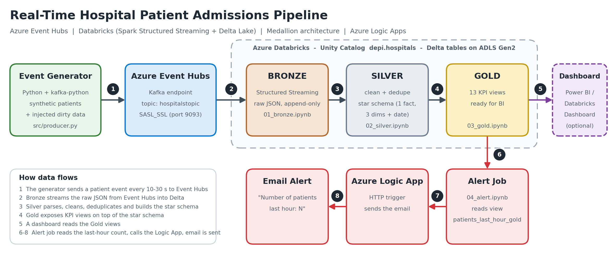
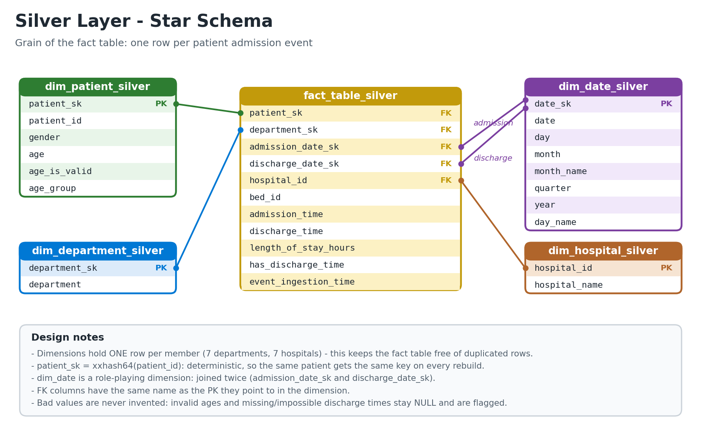

# Real-Time Hospital Patient Admissions Pipeline

An end-to-end streaming data-engineering project on **Azure**. Synthetic patient-admission events are streamed through **Azure Event Hubs**, processed in **Azure Databricks** with a **Medallion architecture** (Bronze → Silver → Gold) on **Delta Lake**, modelled as a **star schema**, and monitored with an **automated email alert** (Azure Logic Apps) when admissions spike.



---

## Table of contents

1. [What this project does](#what-this-project-does)
2. [Tech stack](#tech-stack)
3. [Pipeline layers](#pipeline-layers)
4. [Data model](#data-model)
5. [Data quality rules](#data-quality-rules)
6. [Gold KPI views](#gold-kpi-views)
7. [Alerting](#alerting)
8. [Repository structure](#repository-structure)
9. [How to run it](#how-to-run-it)
10. [Security](#security)
11. [Limitations & next steps](#limitations--next-steps)

---

## What this project does

A hospital network (7 hospitals, 7 departments) produces a continuous stream of patient-admission events. The pipeline:

- **ingests** the events in near real time,
- **keeps the raw data untouched** (Bronze),
- **cleans and models** it into a star schema (Silver),
- **publishes business KPIs** as SQL views (Gold) for dashboards,
- **sends an email alert** when the number of patients received in the last hour reaches a threshold.

The events are generated by `src/producer.py`. About 5–20 % of them are **intentionally dirty** (impossible ages, admission dates in the future, missing discharge times) so the cleaning logic is realistic.

Example event:

```json
{
  "patient_id": "6d9bddeb-0195-4b44-b44d-4af17f08509c",
  "gender": "Male",
  "age": 40,
  "department": "Surgery",
  "admission_time": "2026-09-30T18:08:45.149825",
  "discharge_time": "2026-10-04T09:08:45.149825",
  "bed_id": 216,
  "hospital_id": 4
}
```

## Tech stack

| Area | Technology |
|---|---|
| Ingestion / messaging | Azure Event Hubs (Kafka-compatible endpoint), `kafka-python` |
| Processing | Azure Databricks, Apache Spark (PySpark, Structured Streaming, Spark SQL) |
| Storage | Delta Lake on Azure Data Lake Storage Gen2, Unity Catalog |
| Alerting | Azure Logic Apps (HTTP trigger → email) |
| Language | Python, SQL |

## Pipeline layers

| Layer | Notebook | What happens |
|---|---|---|
| **Producer** | `src/producer.py` | Generates a synthetic patient event every 10–30 s and publishes it to Event Hubs. |
| **Bronze** | `notebooks/01_bronze.ipynb` | Spark Structured Streaming reads Event Hubs and appends the **raw JSON** (plus the Kafka timestamp) to a Delta table. No transformation. |
| **Silver** | `notebooks/02_silver.ipynb` | Parses the JSON, applies the [cleaning rules](#data-quality-rules), removes duplicates and builds the [star schema](#data-model). Runs integrity checks before writing. |
| **Gold** | `notebooks/03_gold.ipynb` | Creates the [KPI views](#gold-kpi-views) used by the dashboard and the alert. |
| **Alert** | `notebooks/04_alert.ipynb` | Reads `patients_last_hour_gold` and calls the Logic App when the threshold is reached. |

> Bronze is a continuous stream. Silver, Gold and Alert are batch notebooks that you run (or schedule as a Databricks Job) on top of the latest Bronze data, so the pipeline is **near real time**, not event-by-event.

## Data model



| Table | Grain | Key |
|---|---|---|
| `fact_table_silver` | one row per patient admission event | — |
| `dim_patient_silver` | one row per patient | `patient_sk` (`xxhash64(patient_id)`) |
| `dim_department_silver` | one row per department | `department_sk` |
| `dim_hospital_silver` | one row per hospital | `hospital_id` |
| `dim_date_silver` | one row per calendar day (2025-01-01 → 2030-12-31) | `date_sk` (`yyyyMMdd`) |

Why it is built this way:

- **Dimensions have one row per member.** An earlier version put `bed_id` inside the department dimension, which made it one row *per event*; joining it back multiplied the fact table (3,000 events became ~1.7 million rows) and silently distorted the averages. `bed_id` now lives in the fact table.
- **Deterministic surrogate keys.** `xxhash64(patient_id)` gives the same key on every rebuild, unlike `monotonically_increasing_id()`.
- **Integrity checks** in the Silver notebook stop the run if the fact row count differs from the clean row count, if a department is unmatched, or if an admission falls outside `dim_date`.

## Data quality rules

Bad values are **never invented**: they become `NULL` and are flagged, so the KPIs stay honest.

| Problem injected by the producer | Rule in Silver | Flag column |
|---|---|---|
| Age > 100 (or < 0) | `age = NULL` | `age_is_valid = false` |
| Admission time in the future | replaced by `event_ingestion_time` (when the event reached Event Hubs) | `admission_time_corrected = true` |
| Missing discharge time | stays `NULL`; length of stay is `NULL` and ignored by averages | `has_discharge_time = false` |
| Discharge before admission (impossible) | treated as missing (`NULL`) | `has_discharge_time = false` |
| Same `patient_id` received twice | only the latest event is kept | — |
| Malformed JSON / missing `patient_id` | row is dropped | — |

The notebook prints a small data-quality report (how many rows needed each fix) after cleaning.

## Gold KPI views

All views live in `depi.hospitals`.

| View | Answers |
|---|---|
| `total_num_patients_gold` | How many patients in total? |
| `avg_stay_hours_gold` | Average length of stay (hours) |
| `patients_by_hospital_gold` | Patients per hospital |
| `top_hospital_gold` | Busiest hospital |
| `top_department_gold` | Busiest department |
| `patients_by_department_gold` | Patients per department |
| `avg_los_by_department_gold` | Average length of stay per department |
| `num_patients_by_gender_gold` | Patients per gender |
| `num_patients_by_age_gold` | Patients per age (valid ages only) |
| `num_patients_by_age_group_gold` | Patients per age group (0-17, 18-39, 40-59, 60+, Unknown) |
| `daily_patients_gold` | Admissions per day |
| `admissions_by_hour_gold` | Admissions per hour of the day (peak hours) |
| `patients_last_hour_gold` | Patients received in the last hour (used by the alert) |

<!-- TODO: add a dashboard screenshot here, e.g.  -->

## Alerting

1. The **Alert** notebook reads `patients_last_hour_gold`.
2. If the value is `>= THRESHOLD` (default `100`; the producer sends ~180 events/hour), it POSTs `{"num_patients_last_hour": N}` to a **Logic App** HTTP trigger.
3. The Logic App sends an email: `Number of patients last hour: @{triggerBody()?['num_patients_last_hour']}`.

Logic App setup:

- Trigger: **When an HTTP request is received** with the JSON schema in [`docs/logic_app_email_template.txt`](docs/logic_app_email_template.txt).
- Action: **Send an email (V2)** using the body template from the same file.
- Copy the generated HTTP POST URL into the `logic-app-url` secret (see below).
- Use `tests/test_logic_app.ipynb` to send a fake value and check that the email arrives.

## Repository structure

```
hospital-realtime-pipeline/
├── README.md
├── requirements.txt            # only for running the producer locally
├── .env.example                # template for local secrets (copy to .env)
├── .gitignore
├── docs/
│   ├── architecture.png
│   ├── star_schema.png
│   └── logic_app_email_template.txt
├── src/
│   └── producer.py             # synthetic event generator → Event Hubs
├── notebooks/                  # import these into Databricks
│   ├── 01_bronze.ipynb
│   ├── 02_silver.ipynb
│   ├── 03_gold.ipynb
│   └── 04_alert.ipynb
└── tests/
    └── test_logic_app.ipynb
```

## How to run it

### 1. Azure resources

| Resource | Notes |
|---|---|
| Event Hubs namespace + event hub | The code uses `depi-eventhub` / `hospitalstopic` — change them in the notebooks/producer if yours differ. Create **two shared access policies**: one with **Send** (producer) and one with **Listen** (Bronze). |
| Storage account (ADLS Gen2) + container | The code uses `storageaccount5326` / `hospitals`. |
| Azure Databricks workspace with Unity Catalog | Create the catalog and schema once: `CREATE CATALOG IF NOT EXISTS depi; CREATE SCHEMA IF NOT EXISTS depi.hospitals;` |
| Logic App | See [Alerting](#alerting). |

### 2. Secrets

Nothing sensitive is stored in the code. In Databricks, create a secret scope and add three secrets (Databricks CLI):

```bash
databricks secrets create-scope hospital-scope
databricks secrets put-secret hospital-scope storage-key            # ADLS storage account key
databricks secrets put-secret hospital-scope eventhub-listen-conn   # connection string of the Listen policy
databricks secrets put-secret hospital-scope logic-app-url          # Logic App HTTP POST URL
```

If your workspace does not allow secret scopes, the notebooks fall back to a **widget** at the top of the page: paste the value there at runtime and clear it before exporting or committing the notebook.

For the local producer:

```bash
cp .env.example .env     # then paste the Event Hub *Send* connection string
pip install -r requirements.txt
```

### 3. Execution order

1. Import `notebooks/*.ipynb` into Databricks.
2. Run **`01_bronze`** and leave it running (it is the streaming query).
3. Start the producer on your machine: `python src/producer.py`
4. After a few minutes of data, run **`02_silver`**, then **`03_gold`**.
5. Run **`04_alert`** (or schedule it).
6. Optional: create a **Databricks Job** with the tasks `02_silver → 03_gold → 04_alert` on an hourly schedule.

## Security

- No keys, connection strings or webhook URLs are committed — they come from Databricks secrets or environment variables.
- The producer needs a **Send-only** policy and Bronze a **Listen-only** policy, instead of `RootManageSharedAccessKey`.
- `.env` is git-ignored. If a secret was ever committed or shared, **rotate it** in the Azure portal (regenerating keys; creating a new Logic App URL).

## Limitations & next steps

- Silver is a **full rebuild** (overwrite) on every run. Next step: incremental processing with Delta `MERGE` or a streaming Silver.
- `discharge_time` in the generated data is a *recorded* value that can lie in the future; the model does not distinguish between "already discharged" and "expected discharge".
- Orchestration is manual; a Databricks Job (or Azure Data Factory) should run Silver → Gold → Alert on a schedule.
- Add a **dashboard** (Power BI or Databricks Dashboards) on top of the Gold views and put a screenshot in `docs/`.
- Add automated data-quality tests (e.g. Great Expectations or Delta constraints) and CI for the Python code.
